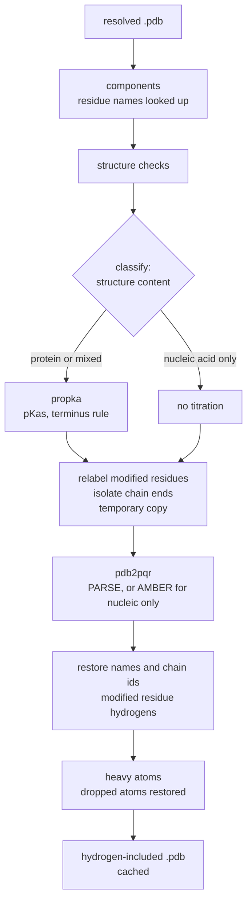
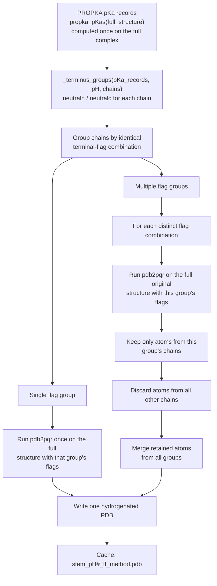

# Hydrogenator

Turns a heavy-atom `.pdb` into one with explicit hydrogens, through two external tools run as subprocesses in a CondaPkg-managed Python environment: pdb2pqr (hydrogen placement) and propka3 (per-residue pKa prediction). It works on files, by path, in the `_cache/` store of `MolecularStructure`; `seed_model` calls it between `resolve_structure` and `load_molecule`. A hydrogen is one electron and a volume, and about 13 % of a protein's electrons (C5H8N1.4O1.5 per residue: 60 electrons, 8 hydrogen; about 7 % for nucleic acids). The scattering contrast is the difference of two nearly equal quantities: with `Z` electrons in volume `V` in solvent of density `ρₑ`, the net count is `Z_net = Z − ρₑ V`, and a relative error `ε` in `Z` alone changes it by

```math
\frac{\delta Z_{net}}{Z_{net}}=\frac{\epsilon}{1-\rho_e/\bar\rho_p},\qquad \bar\rho_p=\frac ZV
```

For a protein (`ρ̄_p ≈ 0.43 e·Å⁻³` in water of 0.334) the amplification is ≈ 4.5: omitting the hydrogens would change the contrast of the whole particle by a factor of order one, not a few percent. (The same reasoning is why `ρₑ` of the buffer must be accurate to a fraction of a percent.)

The caller chooses the **force field** (`ff`, among `FORCE_FIELDS`) and the **titration** (`Propka()` or `NoTitration()`); `seed_model` chooses both from the content (below). Stages around the pdb2pqr call, each a line of the timing log:



Files: `Hydrogenator.jl` (module, `TitrationMethod`, `Propka`, `NoTitration`, `FORCE_FIELDS`, CondaPkg tool paths), `Propka.jl` (propka3, its `.pka` parser, the terminus rule), `Pdb2pqr.jl` (`resolve_hydrogens`, the run, per-chain partition, cache), `Content.jl` (`hydrogenation_choice`, the dropped-nucleotide guard, `modified_hydrogen_deficit`), `Modified.jl` (`relabel_modified`/`restore_modified!`), `ChainEnds.jl` (`isolate_chain_ends`/`restore_chain_ends!`), `Balance.jl` (heavy-atom balance).

## Usage

```julia
using BAYSOL.Hydrogenator: resolve_hydrogens, propka_pKas, Propka, NoTitration

hpath = resolve_hydrogens(pdb_path, pH; titration = Propka())                    # proteins: PARSE + PROPKA
hpath = resolve_hydrogens(pdb_path, pH; titration = Propka(propka_pKas(pdb_path)))  # pKas predicted on this same structure
hpath = resolve_hydrogens(pdb_path, pH; titration = NoTitration())               # nucleic acid alone
```

`resolve_hydrogens(pdb_path, pH; ff, titration)` runs `pdb2pqr --ff <FF> [--titration-state-method propka --with-ph <pH>] [flags] --pdb-output <out> <in> <tmp.pqr>` and returns the path of a hydrogen-included `.pdb` in `_store_dir()` named `<stem>_pH<pH>_<ff>_<method>.pdb` (a repeat call for the same four is a cache hit). `ff` is one of `:amber :charmm :parse :peoepb :swanson :tyl06` (default `DEFAULT_FORCE_FIELD = :parse`; unknown raises `Pdb2pqrError`). `titration` defaults to `NoTitration()`: nothing implies PROPKA. `Propka(pKas)` assumes (does not re-verify) the records were predicted on this structure.

## Choosing the hydrogenation from the content

`seed_model` reads the residue names of the ATOM and HETATM records by a text scan (a file BioStructures rejects still works), looks each up in the component table and chooses (`classify` stage):


| structure content   | `content`  | force field                   | titration       | stages                              |
| --------------------- | ------------ | ------------------------------- | ----------------- | ------------------------------------- |
| amino acids only    | `:protein` | PARSE                         | `Propka(pKas)`  | `propka`, `pdb2pqr`                 |
| DNA/RNA only        | `:nucleic` | AMBER (`NUCLEIC_FORCE_FIELD`) | `NoTitration()` | `pdb2pqr (nucleic, none)`           |
| protein and DNA/RNA | `:mixed`   | PARSE                         | `Propka(pKas)`  | `propka`, `pdb2pqr (mixed, propka)` |

The choice is about robustness, not chemistry: `--pdb-output` places the same hydrogens under PARSE and AMBER (coordinates identical to 0.000 Å on 1BNA, 3HDD, 1CRN; the "zero atoms for DNA" of PARSE holds for the PQR output only). Anything with protein keeps PARSE because the terminus flags `--neutraln/--neutralc` exist only with PARSE (AMBER exits with an error); a nucleic acid alone has none and gets AMBER because PARSE aborts its charge check on chimeras such as 246D (an RNA with one deoxy-C): of 20 nucleic fixtures run through both, 15 gave identical atom counts and AMBER succeeded where PARSE aborted on 246D. Nucleic-acid hydrogens do not depend on pH (identical at pH 1, 7, 13) and PROPKA has no model for bases or phosphates, so a nucleic acid alone runs no PROPKA; in a mixed file the protein stays pH driven.

An unknown residue name carrying at least four of the eight sugar–phosphate atoms `{P, O5', C5', C4', O4', C3', C2', C1'}` is taken to be a nucleotide. After every pdb2pqr run a text scan checks that each input nucleotide has atoms in the output and raises `Pdb2pqrError` naming the residues otherwise.

## Protonation

### From a pKa to a state

For an acid HA ⇌ H⁺ + A⁻, `pH = pKa + log₁₀([A⁻]/[HA])`, so the protonated fraction is

```math
f_{prot}=\frac{1}{1+10^{\,pH-pK_a}}
```

(for a base B the `pKa` is that of BH⁺; the deprotonated fraction is `1/(1+10^{pKa−pH})`). `_group_protonated` reduces both to one rule: a group is charged iff its charged fraction exceeds ½, i.e. a base is charged iff `pH < pKa`, an acid iff `pH > pKa`, and a group exactly at its `pKa` rounds to uncharged. A group within ≈ ±1 pH unit of its `pKa` is really a mixture (a base at `pH − pKa = −1, 0, +1` is 91 %, 50 %, 9 % protonated) and pdb2pqr places one state; the same groups carry the full fraction in the buffer volume model (BulkElectronDensity).

### PROPKA

Burial, hydrogen bonding and nearby charges shift a titratable group's `pKa` inside a folded protein; PROPKA predicts the shift. `propka_pKas(pdb_path)` runs propka3 once per structure in a private temporary directory in the cache (the `.pka` is cached as `<stem>.pka`), reads it and returns one record `(resname, resnum, chain, pKa)` per standard titratable group (ASP, GLU, CYS, TYR, HIS, LYS, ARG, and the free termini `N+`, `C-`); ligand rows (an extra atom-type column) are skipped and a trailing `*` (coupled residue) stripped. PROPKA reads the whole complex, so the records are computed once and reused for every chain.

### Termini

pdb2pqr's terminus handling is not pH driven (a fixed charged state). Under `Propka`, `_terminus_groups(pKa_records, pH, chains)` overrides it from the `N+`/`C-` records: a free N-terminus (base) gets `--neutraln` when deprotonated, a free C-terminus (acid) gets `--neutralc` when protonated. The flags are global to a pdb2pqr call, so if chains round differently no single run represents them:

1. compute the flags of every chain from its own records (a chain with none has no free terminus);
2. group the chains by identical flag set (at most four groups, almost always one);
3. one group: a single run on the full structure; several: run on the full original structure once per combination, keep only that group's chains, and merge the retained atoms (exact, since each chain's hydrogens depend only on its own flags).



The conflict check needs only the PROPKA records, so the common case costs nothing extra; the worst case is four pdb2pqr runs (~1 s each on a small protein against ~9 s for the first PROPKA run in a process). `Pdb2pqrError` is raised when pdb2pqr cannot be run or yields no usable output.

## Nucleic acids

**Legacy names.** Older and CHARMM files name the bases `ADE GUA CYT URI THY` (`DAD DCY DGU DTH` are not included: the dictionary has them as D-amino acids and a sugar). The wwPDB uses these ids for the free bases, so `component("ADE")` stays `:other` and the rule needs atoms: a residue is a nucleotide when it has a `P` atom, or at least four of the eight backbone atoms **and** its chain has at least two such residues (a free adenine or adenosine, a lone residue, and ATP/GTP/NAD, whose ids are not in the list, are therefore not mistaken). `THY` is DNA, `URI` is RNA, `ADE GUA CYT` are RNA when the residue has an `O2'` (or `O2*`), else DNA. They are run as the canonical standard names (measured on relabelled 1SDR/1BNA residues: pdb2pqr exits on `ADE`/`URI` in a ribonucleotide chain and places no hydrogen on `CYT GUA THY`) and get their names back; the content scan, the guard, the loader and the hydrogenation all use the rule.

**DNA written as RNA.** pdb2pqr treats a residue named `A C G U` as RNA, so a deoxy DNA written with bare letters (SASDAN8) would get an `O2'` added to every `A C G` and no hydrogen on `T`. In the temporary copy, a residue named `A C G U` with **no** `O2'` is relabelled `DA DC DG DT` (a `U` without `O2'` becomes `DT`) and every `T` becomes `DT`; names are restored afterwards. The decision is per residue, so a chain mixing both (246D) is handled; the cost is that an RNA residue whose `O2'` is merely missing is taken for DNA. On SASDAN8 no `O2'` is added (2044 atoms plus 1111 hydrogens, hydrogens on the thymines).

**Chain ends.** pdb2pqr patches the 5' end of a nucleic chain only if its first residue is nucleic and the 3' end only if its last is; a lone patch leaves a fractional charge and its total-charge check aborts (SASDNP7: a tRNA ending in MET101; SASDWJ4: a leading 5' GTP). `isolate_chain_ends` gives the leading and trailing non-nucleotide run of a nucleic chain (over the whole chain id and each TER segment) a fresh chain id in the temporary copy, and `restore_chain_ends!` maps the ids back before `restore_modified!`/`restore_dropped_atoms!` and removes the `OXT`/`HXT` pdb2pqr adds to an isolated aminoacyl residue unless the input has them. Ligands pdb2pqr drops (GTP, GNP) are not put back (the loader drops ligands anyway). Implemented and unit-tested (`bb unit chain_ends`), **not yet fitted**.

## Modified residues

pdb2pqr knows only the standard residues. In the temporary copy of its input each modified residue with a known parent is renamed to it with record type ATOM (the standard residue of its base for a nucleotide: RNA `A C G U`, DNA `DA DC DG DT`; the standard amino acid for a modified one, `MSE` → `MET`, `SEP` → `SER`, via `amino_parent`); after the run `restore_modified!` gives each residue its own name, record type, element and original coordinates, matched on chain, number and insertion code stripped (writers align the number differently and pdb2pqr realigns it; a blank chain id comes back named by pdb2pqr and is then matched on the number). Atoms the parent names differently run under the parent's name (`AMINO_ATOM_ALIASES`: the selenium of `MSE` runs as `SD`, without which pdb2pqr drops it and builds a sulfur 2.4 Å away). Heavy atoms that exist only in the modification (the phosphate of `SEP`, `TPO`, `PTR`) are put back by the balance step. Stage notes: `modified nucleotide hydrogens` and `modified amino acid hydrogens` (`[N residues: N hydrogenated through their parent, M without a parent; X hydrogens placed]`).

- **Nucleotides.** The base is the declared parent of the component, else the inferred `base` of the table. An RNA component with base T is run as `U`; a DNA component with base U as `DT` (pdb2pqr accepts `DU` but places no hydrogen on it). On 1EHZ (tRNA-Phe) all 14 modified residues (11 types) have a base: no heavy atom is lost (323 of 323) and 149 hydrogens are placed, against 0 when left alone; the formulas of the 14 components carry 232, so **83 are missing**, ≈ 0.7 % of the electrons of the 76-nt tRNA (about 12,600), a few percent of its contrast with the amplification of 2.5–4.5 above. This approximation (hydrogens that exist only in a modification, such as a methyl's, are not placed; a modified base without a known base gets none; a ligand such as `DCP` is not a nucleotide) is accepted knowingly and recorded as open. `modified_hydrogen_deficit` reports both counts.
- **D amino acids** are not run as their L parent: pdb2pqr places hydrogens from the L form's internal coordinates (a mirrored alanine run as `ALA` got its `HA` 0.58 Å from `CB`, against 2.05 Å). A D residue keeps its heavy atoms and gets no hydrogens (any already in the file stay).
- **Incomplete residues** run as the parent only if they have every heavy atom of the parent (`STANDARD_AMINO_ATOMS`; `MSE`'s selenium counts as `SD`), because pdb2pqr invents the atoms a residue lacks (homoserine, 32 residues written as ATOM records in SASDR99, run as `SER` would acquire an `OG` and lose the input's hydrogens); this also keeps the SASDR99 baseline.
- A parent that is itself non-standard is followed up the table; if the chain does not end in a standard residue, or several different parents are listed, the residue has none and keeps its heavy atoms without hydrogens. Terminal variants (`… amino terminus`) run as their parent. `UNK` and any unknown or non-peptide HETATM residue stays dropped by the loader.
- Evidence: SASDH39 gains its 160 selenomethionine atoms and 183 hydrogens; a synthetic RNase A with one `MET` renamed `MSE` gives the same atoms and hydrogens as the original; crystal structures with `MSE` (1A62), `SEP` (1VRV) and `PTR` (1AYB) build on the protein route. PROPKA now sees the modified residues, which moves some pKas by a few tenths (an `MSE` N-terminus 6.01 against 7.34), but the terminus flags at the pH of the fit were identical on all three.

## Heavy atoms

pdb2pqr's `5TERM` patch deletes `P`, `OP1`, `OP2` of the first nucleotide of every chain (1EHZ A1 loses its phosphorus: 1652 → 1651 heavy atoms) and gives its `O5'` an `H5T`. After each run `restore_dropped_atoms!` compares input and output heavy atoms residue by residue and re-attaches every input atom that has neither an output atom of the same name, nor one within 0.01 Å in its residue, nor a *new* output atom within 3 Å to pair with (pdb2pqr renames some atoms, such as carboxylate `OC1`/`OC2` → `O`/`OXT`, and its HIS/ASN/GLN flips move others: neither is a loss), with the input's coordinates, occupancy, B-factor and element; a restored phosphorus removes the `H5T`. Atoms pdb2pqr **adds** (a protein `OXT`) are only counted and warned about. Counts go beside the cache file (`<file>.balance`) and into the `heavy atoms` stage (`[1821 in, 1821 out; 1 restored, 0 added by pdb2pqr]`; counts include waters and ions of the input).

## Robustness

- Chains and per-group outputs are read and merged **by text** (the chain-id column, lines verbatim), so files pdb2pqr accepts but BioStructures does not still work.
- Hybrid-36 atom serials (`B0205`, files over 99,999 atoms) are not read by pdb2pqr: the temporary copy renumbers its atoms (ANISOU and CONECT records are left out).
- Reused chain ids and duplicate atoms are repaired in the copy (`MolecularStructure.sanitized_copy`); the new ids never reach the scattering model.
- The standard error of pdb2pqr and propka3 goes to a file in the temporary directory, and the last relevant lines (`ValueError`, `RuntimeError`, `CRITICAL`, `non-integer charge`, `Giving up`) go into `Pdb2pqrError`/`PropkaError`.
- **Atomic, single computation per structure.** Every output is written in a private temporary directory inside the cache and moved into place with a rename in one directory (atomic on POSIX), so a concurrent reader sees the whole file or none; a per-path lock (`KeyedCache{String,ReentrantLock}`) lets exactly one thread run propka3 per structure while the others wait and find the cached `.pka`.

## Open items

Modified bases without a known base get no hydrogens, and hydrogens that exist only in a modification are not placed. Nucleotides are taken as supplied: no pKa model for nucleotide protonation (decided).

```

```
